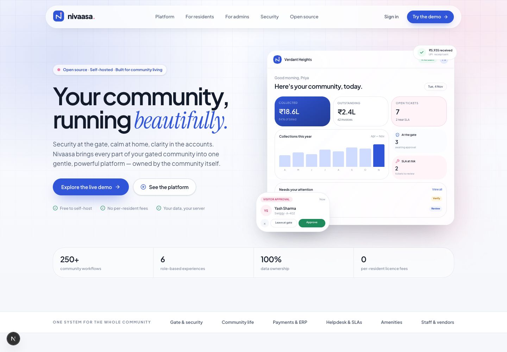
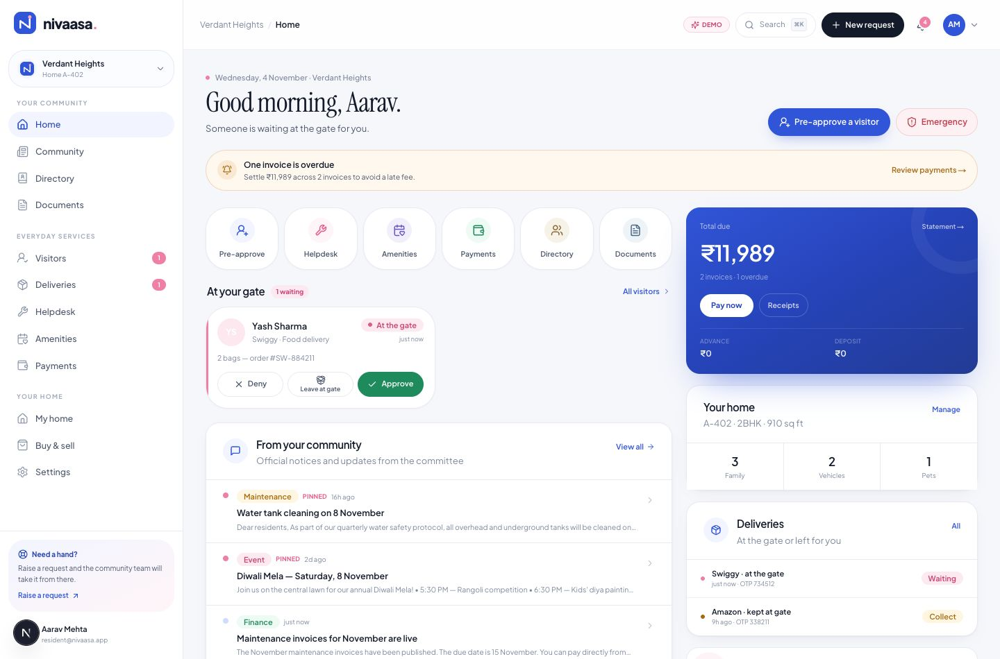
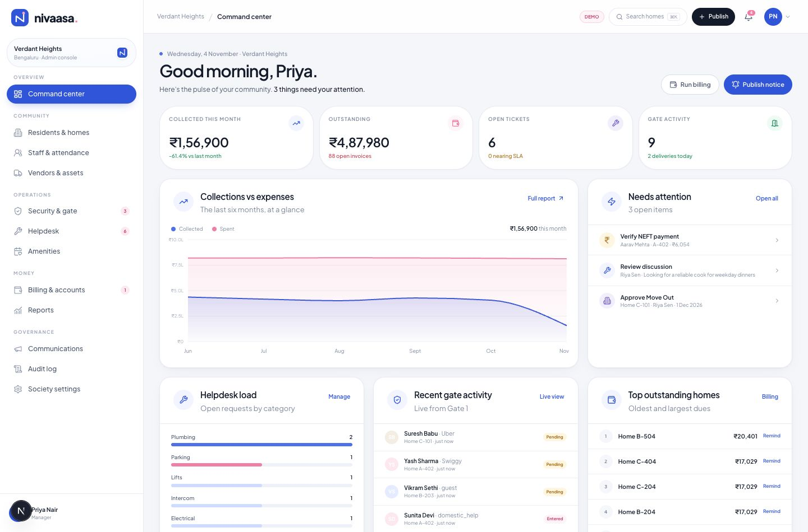
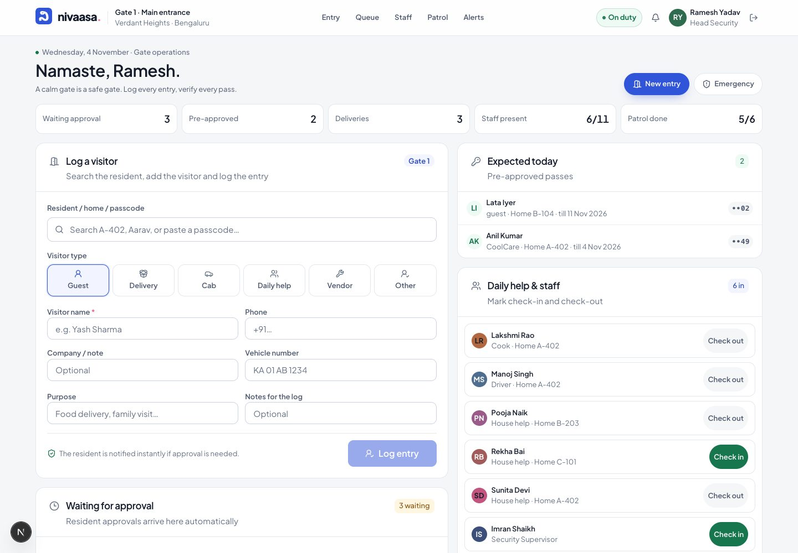
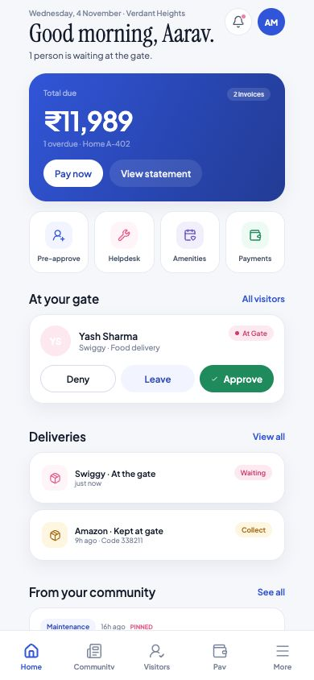

# Nivaasa

**The open-source operating system for gated communities.**
Security at the gate, calm at home, clarity in the accounts — owned by the community.

Nivaasa is a self-hosted, multi-tenant community platform for resident welfare associations, apartment complexes and managed townships. It covers the same ground as a managed society ERP — visitor management, community, helpdesk, amenities, maintenance billing, accounting, staff, vendors, security and administration — without per-resident licences, vendor lock-in or a third party holding community data.

> Built as a functional, open-source alternative to MyGate-style community platforms, with an entirely original brand, design system and codebase.

[](https://github.com/karthikmprakash/nivaasa/actions/workflows/ci.yml)
[](https://github.com/karthikmprakash/nivaasa/actions/workflows/docker.yml)
[](https://github.com/karthikmprakash/nivaasa/releases)
[](https://github.com/users/karthikmprakash/packages/container/package/nivaasa)
[](LICENSE)





## What's inside

| Surface | What you get |
| --- | --- |
| **Resident web + mobile** | Approvals, pre-approved passes, deliveries, payments, receipts, helpdesk, amenities, notices, polls, events, discussions, classifieds, directory, documents, household, e-Intercom, emergency |
| **Admin console** | Live operations dashboard, residents & homes, security, helpdesk, amenities, billing & accounting, reports, communications, staff, vendors, assets, audit log, society settings |
| **Guard console** | Visitor entry, passcode verification, queue, delivery handover, daily-help attendance, patrol checkpoints, panic response |
| **Portfolio** | Cross-society view for management companies and developers |
| **Native apps** | Expo/React Native resident app and guard console for Android + iOS |

### Modules in detail

- **Gate & security** — spot visitor requests, pre-approved passes with 6-digit codes, delivery logging with leave-at-gate OTP, domestic-help attendance, patrol checkpoints, panic alerts, visitor overstay and full gate history.
- **Community** — official notices with audience targeting, moderated discussions, comments, polls (including secret and owner-only), events with RSVP, classifieds and a privacy-first resident directory.
- **Billing & ERP** — unlimited billing heads, per-sq-ft/fixed/per-slot pricing, scheduled runs, GST-ready items, late fees, invoices, offline payment intimations, verification queue, receipts, advances, expenses, vendors, assets and audit-ready reports.
- **Helpdesk** — categories, scope (personal/common), priorities, SLA clocks, assignment, internal notes, resident conversation, reopening, ratings and escalations.
- **Amenities** — live availability, configurable slots, capacity, pricing, deposits, house rules, household fair-use limits, cancellation/refund policy and booking history.
- **Household** — family members, vehicles, pets, daily help profiles, move requests, e-Intercom numbers and emergency contacts.
- **People ops** — society staff, security, daily help, ID verification, attendance and monthly payroll summary.
- **Governance** — role-based access, append-only audit log, multi-society portfolio, configurable community policies, banking details and exportable records.
- **Payments** — a complete UPI/card/net-banking flow in demo mode; replace with Razorpay or Stripe in production.

## Screenshots

| Admin command center | Guard console |
| --- | --- |
|  |  |

| Native resident app (Expo web preview) |
| --- |
|  |

## Design system

- **Brand** — Nivaasa (Kannada **ನಿವಾಸ**, “the place we live”). Blue tile, ink, white and blush; see [`brand/README.md`](brand/README.md).
- **Type** — Plus Jakarta Sans for UI, Instrument Serif for editorial moments.
- **Icons** — Lucide across web, mobile and admin.
- **Surfaces** — soft off-white canvas, fine borders, restrained shadows, 10px controls, 16px panels and 20px overlays.
- **Charts** — Recharts with readable axes, distinct line styles and accessible data tables.
- **Type scale** — 12px captions, 14px body, 16px section titles and 28–30px page titles.
- **UI architecture** — shared role-aware navigation, one responsive application shell, accessible field context and URL-backed view tabs.

See [DESIGN.md](DESIGN.md) for the interface standards and implementation boundaries.

Shared tokens live in [`apps/web/src/app/globals.css`](apps/web/src/app/globals.css) and [`apps/mobile/lib/theme.ts`](apps/mobile/lib/theme.ts).

## Brand

The mark is the Kannada syllable **ನಿ** (*ni*), the first sound of **ನಿವಾಸ**, with a blush window lit inside its loop. The full identity — blue tile, lockups, wordmark, icons, social assets, colour tokens and the motion pack (animated WebP, HEVC alpha, APNG, MP4/GIF) — lives in [`brand/`](brand/README.md).

The website uses the blue-tile mark across the nav, login, app shell, footer and receipts, the mark-write animation in the landing CTA, and the success check on receipts.

## Quick start

Requirements: **Node.js 22+** and npm 10+.

```bash
git clone https://github.com/karthikmprakash/nivaasa.git
cd nivaasa
npm run setup     # install, create the SQLite schema, seed the demo community
npm run dev       # http://localhost:3000
```

The seed creates **Verdant Heights** (Bengaluru, 72 homes) and **Lakeview Residences** (Pune). All demo accounts use the password **`demo1234`**:

| Account | Role |
| --- | --- |
| `resident@nivaasa.app` | Aarav Mehta, resident (A-402) |
| `admin@nivaasa.app` | Priya Nair, community manager |
| `guard@nivaasa.app` | Ramesh Yadav, Gate 1 security |
| `accountant@nivaasa.app` | Sanjay Rao, accountant |
| `committee@nivaasa.app` | Neha Kulkarni, committee secretary |
| `owner@nivaasa.app` | Vikram Shah, portfolio owner (multiple societies) |

The sign-in page also has one-click demo buttons.

### Mobile / native apps

```bash
cd apps/mobile
EXPO_PUBLIC_API_URL=http://YOUR_LAN_IP:3000 npx expo start
```

- Press `a` for an Android emulator, `i` for the iOS simulator, or scan the QR code with Expo Go.
- Use your machine's LAN IP (not `localhost`) when testing on a physical device. Android emulators can use `http://10.0.2.2:3000`.
- Build store binaries with EAS: `eas build --platform android` / `--platform ios`. Bundle IDs are prefilled in `apps/mobile/app.json`.

The mobile app covers the resident experience (home, approvals, pre-approvals, community, payments, helpdesk, amenities, directory, documents, notifications) and a guard console (queue, entry recording, passes, deliveries, patrol). The web admin console remains the full administrative surface.

## Architecture

```
apps/
  web/               Next.js 16 App Router, React 19, Tailwind 4, Drizzle + SQLite
    src/app/         Marketing, auth, resident app, admin, guard, portfolio, API
    src/db/          Schema + demo seed
    src/components/  Design system, feature clients, shells
  mobile/            Expo SDK 58, Expo Router, React Native 0.88, Reanimated
  web/public/        Brand assets, sample documents, uploads
docker/              Production entrypoint
scripts/             Icon and sample-document generators
data/                SQLite database (gitignored)
```

- **Web and API** — Next.js server components for fast initial renders; route handlers for interactive and mobile APIs; server actions for mutations.
- **Database** — SQLite via better-sqlite3 and Drizzle ORM. The schema is portable to Postgres. `npm run db:push` applies schema changes; `npm run db:seed` reseeds the demo.
- **Auth** — HTTP-only session cookies for the web and bearer tokens for mobile. Passwords are scrypt-hashed, sessions expire after 7 days, and login attempts are rate-limited in memory.
- **Multi-tenancy** — every core row is scoped by `society_id`; role and unit checks are enforced server-side on every API route and action.
- **Realtime-ish** — visitor queue polls every 12 seconds; every approval, payment and entry is written to the audit log immediately.
- **Files** — helpdesk photos and document PDFs are stored in `public/uploads` and `public/documents`; mount them as volumes in production.

### Data model

More than 40 tables covering societies, towers, units, users, memberships, families, vehicles, pets, staff, attendance, vendors, assets, billing heads, invoices, invoice items, payments, expenses, amenities, bookings, notices, discussions, comments, polls, votes, events, RSVPs, classifieds, documents, visitors, deliveries, helpdesk tickets, comments, patrols, panic alerts, move requests, notifications, audit logs and sessions.

See [`apps/web/src/db/schema.ts`](apps/web/src/db/schema.ts).

## Production

### Docker

```bash
SEED_DEMO=true docker compose up --build
```

- The entrypoint applies the schema and seeds a fresh database only when one does not exist.
- Set `SEED_DEMO=false` for a real deployment and onboard the first community at `/onboarding`.
- Persist `data/` and `apps/web/public/uploads/`.
- Put a reverse proxy with TLS in front and set `NEXT_PUBLIC_APP_URL` accordingly.

### Container image

Every push to `main` and every `v*` tag publishes a multi-arch (`linux/amd64` + `linux/arm64`) image to GHCR:

```bash
docker pull ghcr.io/karthikmprakash/nivaasa:1.0.4
```

For Dokploy, use [`docker-compose.dokploy.yml`](docker-compose.dokploy.yml) and follow [`docs/deploy-dokploy.md`](docs/deploy-dokploy.md). The compose file expects a named `nivaasa-data` volume for SQLite and `nivaasa-uploads` for uploads.

### Required environment

```env
DATABASE_PATH=../../data/nivaasa.db   # local; /app/data/nivaasa.db in the container
NEXT_PUBLIC_APP_URL=https://community.example.com
CORS_ORIGIN=https://app.example.com
NEXT_PUBLIC_DEMO_MODE=false
SEED_DEMO=false
# Optional production payment provider
RAZORPAY_KEY_ID=
RAZORPAY_KEY_SECRET=
```

### Onboarding a real community

Visit `/onboarding` and create a community, admin account, towers and homes in three steps. Nivaasa creates default billing heads, amenities and a welcome notice. You can then add residents one by one from **Residents & homes** or extend the included CSV export shape for a bulk import.

## Integrations

The payment step is intentionally provider-agnostic. The demo gateway performs a complete checkout, updates invoices, issues receipts and notifies accounts without moving money. To go live:

1. Add your provider keys (Razorpay or Stripe).
2. Replace the simulated success in `apps/web/src/app/api/payments/route.ts` with a provider order + webhook.
3. Keep the existing receipt/ledger flow — it is provider-independent.

Other integration points:

- **e-Intercom** — swap the demo approval flow for Exotel/Twilio voice calls. The unit already stores primary and secondary numbers.
- **WhatsApp / SMS / email** — notifications are stored in-app today; add a channel adapter where `notifications` rows are created.
- **Tally** — payment, invoice and expense exports are available as CSV from `/api/admin/export?type=...`.
- **Boom barriers / ANPR** — gate entries are written through a single `/api/gate/entry` contract; a barrier controller can subscribe to approved passes.
- **Prepaid meters** — billing heads support `meter` basis and can be linked to a provider.

## Security notes

- Role checks and unit scoping are enforced server-side; admin and guard APIs do not trust client roles.
- All financial mutations, visitor actions, role changes and security events are written to the append-only audit log.
- The resident directory is opt-in, phone numbers are masked, and society data is never sent to a third party by default.
- Uploaded images are type- and size-checked (max 3 images, 6 MB each).
- The demo credentials are intentionally public. Disable demo persona login in production with `NEXT_PUBLIC_DEMO_MODE=false` and rotate all seeded credentials.

Nivaasa does not claim any certification. Self-hosters are responsible for their own backups, TLS, access policies and statutory retention obligations.

## Scripts

```bash
npm run dev          # web dev server
npm run build        # production build
npm run start        # production server
npm run setup        # install + schema + demo seed
npm run db:push      # apply schema changes
npm run db:seed      # wipe and reseed demo data (destructive)
npm run typecheck    # web types
npm run check        # web + mobile typecheck
npm run test:ui --workspace @mycommunity/web  # UI behavior regressions
```

## What is deliberately demo-only

To keep this repository honest:

- **Payments are simulated.** No money moves until a real gateway is connected.
- **No real email/SMS/WhatsApp provider** is bundled. All operational notifications are in-app.
- **No vendor bidding portal.** The vendor register, contracts, expenses and procurement workflow are represented; multi-vendor quote submission is on the roadmap.
- **Mobile admin is a companion view.** The full admin surface is the responsive web console; the native app focuses on residents and guards.
- **Single-file SQLite** is the default for one-command setup. Swap the Drizzle dialect to Postgres for large multi-society deployments.

## Reference and scope

See [docs/reference-notes.md](docs/reference-notes.md) for the public-source observation log, the feature matrix against MyGate-style capabilities, and the explicit unknowns.

## Roadmap

- Postgres adapter and migration path
- Bulk resident import with validation preview
- Vendor quote portal and purchase-order approvals
- Razorpay + Stripe webhooks and reconciliation
- WhatsApp Business / SMS / email channel adapters
- Native admin screens and push notifications
- Open API tokens and webhooks for community integrations

## Contributing

Read [CONTRIBUTING.md](CONTRIBUTING.md), [CODE_OF_CONDUCT.md](CODE_OF_CONDUCT.md) and [SECURITY.md](SECURITY.md). Use the issue templates for bugs and feature requests; report vulnerabilities through GitHub Security Advisories, never as public issues.

## License

MIT. See [LICENSE](LICENSE).

---

Built with care for communities that deserve software they own.
