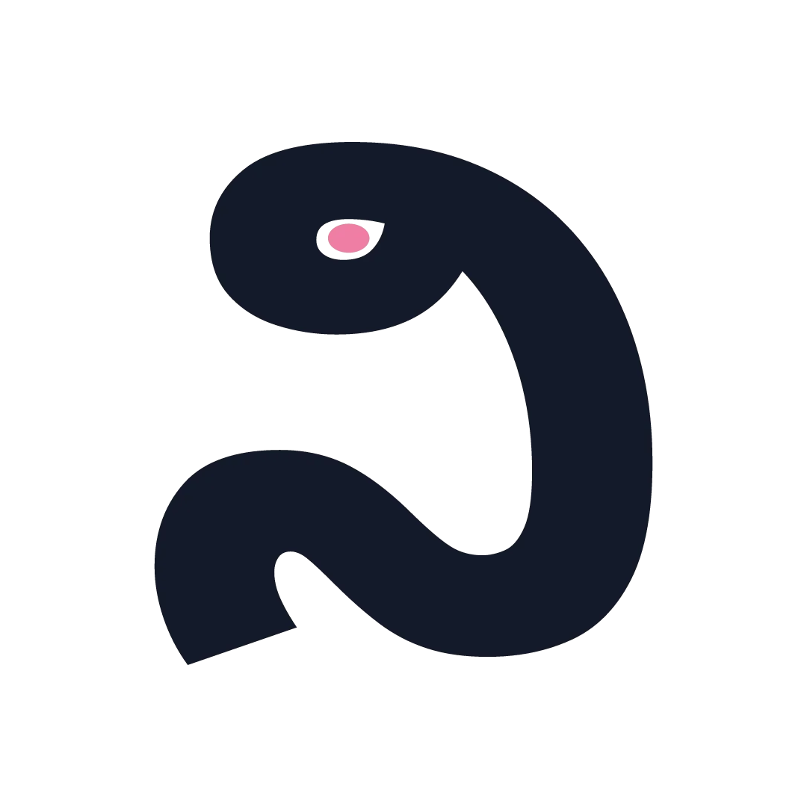

# Nivaasa — brand pack

**ನಿವಾಸ** · *the place we live*

Nivaasa needed a mark that could only belong to this product. The earlier N monogram was clean but generic; this pack starts again from the Kannada word **ನಿವಾಸ** (nivāsa), and builds the identity around its first syllable, **ನಿ** (ni).

---

## The mark

Two parts, one idea:

| Part | What it is | What it means |
|---|---|---|
| **The letter** | **ನಿ** (*ni*), the first sound of ನಿವಾಸ, drawn as a continuous ribbon | A home, a path, a courtyard — the place you return to |
| **The window** | A small blush oval inside the letter's loop | A light left on. Warmth, safety, someone home |

An earlier study added a separate horizontal headstroke above the letter, reading it as a roofline. It was removed: **ನಿ** already carries its own top line, and the bare letter is more faithful to the script, more fluid, and more distinctive at small sizes. The working study is kept in `source/roof-refinement.png` for reference.

The mark is deliberately bilingual: the symbol is Kannada, the wordmark is Latin. Together they say the name twice, in the two scripts the brand lives between.

The wordmark keeps the established lowercase **nivaasa.** in Plus Jakarta Sans ExtraBold, with the blush period as the smallest echo of the window.

### Construction

- Drawn from the Kannada glyph and outlined — no font is required to use the mark.
- Mark width ≈ **0.952 ×** its height.
- The window sits at **39%** of the width and **18.4%** of the height, sized **8.35% × 5.57%** of the mark.
- Clearspace: **25% of the mark height** on all sides.
- Minimum size: **24 px** digital (mark), **48 px** for the full lockup; **8 mm** print.

### Do / don't

- **Do** use the blue tile on busy or photographic backgrounds.
- **Do** use the mono mark (no blush window) when only one ink is available.
- **Do** keep the blush window on light and blue. It is the only warm note.
- **Don't** stretch, rotate, outline, or add effects to the mark.
- **Don't** put the ink mark on saturated blue, or the white mark on light grey.
- **Don't** recreate the Kannada letter in another typeface; use the supplied vector mark.

---

## Colour

| Token | Hex | Use |
|---|---|---|
| Ink | `#131A2A` | Text, mark on light |
| Blue | `#3155D8` | Primary brand, app tile |
| Blue deep | `#223B94` | Pressed / dark blue |
| Periwinkle | `#7795F7` | Supporting blue |
| Blush | `#EF7FA4` | The lit window, period, accent |
| Blush soft | `#F6ABC4` | Soft blush surfaces |
| Canvas | `#F5F6F8` | Page and app canvas |
| Surface | `#FFFFFF` | Cards, reverse |
| Line | `#E3E7EE` | Hairlines |
| Brand wash | `#E7EDFF` | Pale brand fields, watermark |
| Blush wash | `#FDEAF0` | Pale blush fields |

Machine-readable tokens live in [`tokens/colors.json`](tokens/colors.json) and [`tokens/tokens.css`](tokens/tokens.css).

## Type

- **Wordmark / UI:** Plus Jakarta Sans — ExtraBold for the wordmark, Medium–Bold for UI. Tracking `-0.045em`.
- **Kannada mark:** Noto Sans Kannada Black, outlined into the supplied SVGs.
- **Kannada secondary wordmark:** Noto Sans Kannada Medium.

Both families are licensed under the SIL Open Font License 1.1. The Plus Jakarta licence is included at `source/fonts/PlusJakartaSans-OFL.txt`; Noto Sans Kannada is available from Google Fonts under the same licence.

---

## Files

```
brand/
├── svg/                 production vectors (text outlined)
│   ├── nivaasa-mark.svg
│   ├── nivaasa-mark-white.svg
│   ├── nivaasa-mark-mono.svg
│   ├── nivaasa-logo-horizontal.svg
│   ├── nivaasa-logo-horizontal-reverse.svg
│   ├── nivaasa-logo-horizontal-mono-black.svg
│   ├── nivaasa-logo-horizontal-mono-white.svg
│   ├── nivaasa-logo-stacked.svg
│   ├── nivaasa-logo-bilingual.svg
│   ├── nivaasa-wordmark.svg
│   ├── nivaasa-wordmark-kannada.svg
│   ├── nivaasa-icon.svg              (rounded, transparent corners)
│   ├── nivaasa-icon-square.svg       (full-bleed iOS / PWA)
│   ├── nivaasa-favicon.svg
│   ├── nivaasa-avatar.svg
│   ├── nivaasa-banner.svg
│   └── nivaasa-post.svg
├── png/                 raster exports
│   ├── nivaasa-mark-1024.png / -512 / -128
│   ├── nivaasa-mark-white-512.png
│   ├── nivaasa-logo-horizontal-3200.png / -1600
│   ├── nivaasa-logo-horizontal-reverse-1600.png
│   ├── nivaasa-logo-horizontal-mono-black-1600.png
│   ├── nivaasa-logo-horizontal-mono-white-1600.png
│   ├── nivaasa-logo-stacked-1600.png
│   ├── nivaasa-logo-bilingual-1600.png
│   ├── nivaasa-wordmark-2400.png
│   ├── nivaasa-wordmark-kannada-2400.png
│   ├── nivaasa-icon-1024.png / -512 / -192
│   ├── nivaasa-apple-touch-180.png
│   ├── nivaasa-icon-rounded-512.png
│   ├── nivaasa-icon-maskable-512.png
│   ├── nivaasa-favicon-180.png / -32 / -16
│   ├── nivaasa-notification-96.png / -24
│   ├── nivaasa-avatar-512.png
│   ├── nivaasa-banner-1500.png
│   └── nivaasa-post-1080.png
├── animations/          app-ready motion
├── source/              editable VectorCraft + EffectCraft files, font, boards
├── tokens/
├── index.html           local preview (open in a browser)
└── README.md
```

---

## Motion

All animation is built in **EffectCraft** from two mark elements (the letter and the window), so the light can move independently. The project is `source/nivaasa-animations.ecproj`; alpha PNG sequences are in `animations/frames/`.

| Animation | Length | Loop | Use |
|---|---|---|---|
| **Ink reveal** | 3.3 s | one-shot | Hero brand film, landing page, launch |
| **Mark write** | 2.6 s | one-shot | Mark-only cut on light |
| **Blue mark write** | 2.6 s | one-shot | Blue tile logo reveal; website CTA; app icon moments |
| **Mark reveal** | 2.4 s | one-shot | Splash, boot, first paint |
| **Logo reveal** | 2.8 s | one-shot | Marketing, 16:9 video |
| **Mark loop** | 2.0 s | seamless | Loading, waiting, “syncing” |
| **Success check** | 1.8 s | one-shot | Payment, visitor approval, saved |

**The ink reveal** is the hero cut. A single blush thread draws the route through **ನಿ**; a wide, soft matte follows it, so the ink accumulates behind the line rather than fading in. The thread disappears as the letter becomes whole, the window switches on, and the name arrives. One line, one home — no chasing dot.

The earlier light-travel study is kept as an alternate in `animations/nivaasa-light-reveal.*`; it is not the recommended cut.

The compact **mark reveal** is the same idea at app-splash length: **letter → light → name**. **Blue mark write** is the blue-tile version used in the website CTA: the white mark writes itself inside the app icon and the window lights. **Mark write** is the same cut on transparent light. Both end on the mark, without the wordmark. In the loop, only the window breathes, so it can sit beside text without pulling focus.

### Formats

Each animation ships as:

- **`.webp`** — animated, full alpha, small. Best default for web and Android (`expo-image` supports it).
- **`.apng`** — animated PNG, full alpha. Broad browser fallback. (No APNG for the 1920 logo reveal, the light reveal, the ink reveal or the mark-write cuts; they would be unnecessarily large.)
- **`.mov`** — HEVC with alpha. Use in Safari / iOS `<video>` for true alpha video.
- **`.mp4`** — H.264 on the canvas colour. Social, decks, apps that cannot take alpha.
- **`-blue.mp4`** — H.264 on brand blue. Same, for blue placements.
- **`.gif`** — 540 px preview on canvas. Docs and chat.
- **`-540.webp`** — half-size animated WebP for mobile / tight surfaces.
- **`-poster.png`** — transparent still at the resolved frame.

The `animations/preview/` folder holds looping 540 px copies used by `index.html`; the files above are the delivery versions (one-shot where noted). The light reveal is the largest asset (about 1.7 MB at 1080); the ink reveal is about 0.9 MB. Use a 540 px copy or the compact mark reveal when weight matters.

Recommended web use:

```html
<!-- transparent loop, 40 px -->


<!-- alpha video in Safari / iOS -->
<video autoplay muted loop playsinline>
  <source src="/brand/animations/nivaasa-mark-loop.mov" type="video/quicktime" />
</video>

<!-- reduced motion: use the still -->
<picture>
  <source srcset="/brand/png/nivaasa-mark-128.png" />
  
</picture>
```

In React Native, prefer the animated WebP:

```tsx
import { Image } from "expo-image";
<Image source={require("@/assets/brand/nivaasa-mark-loop.webp")} style={{ width: 40, height: 40 }} />
```

Respect `prefers-reduced-motion`: show the still mark and skip the reveal.

---

## Source

- `source/nivaasa-logo.vectorcraft` — mark, lockups, wordmarks, all artboards.
- `source/nivaasa-icons.vectorcraft` — icons, avatar, banner, post.
- `source/nivaasa-motion-layers.vectorcraft` — the glyph, window and full-mark layers used by the animations.
- `source/nivaasa-animations.ecproj` — EffectCraft project with the compact mark reveal, 16:9 logo reveal, loop and success check.
- `source/nivaasa-ink-reveal.ecproj` — EffectCraft project for the 3.3 s ink reveal.
- `source/nivaasa-mark-write.ecproj` — EffectCraft project for the 2.6 s mark-only cut.
- `source/nivaasa-blue-mark-write.ecproj` — EffectCraft project for the blue-tile cut used on the website.
- `source/nivaasa-light-reveal.ecproj` — the earlier 3.8 s light-travel study, kept as an alternate.
- `source/fonts/` — Plus Jakarta Sans ExtraBold/Medium and its licence.
- `source/exploration-01.png`, `refinement-02.png`, `kannada-exploration.png`, `mark-compare.png`, `kannada-house-test.png`, `roof-refinement.png` — the working boards that led here, including the roof-line study that was set aside.

Rebuild scripts are in the repo at `scripts/build-final-logo.mjs`, `scripts/build-final-icons.mjs`, `scripts/build-anim-layers.mjs`, `scripts/anim-final.mjs`, and `scripts/encode-animations.sh`.

---

## Integration status

Applied in the web app on 4 November 2026:

- The blue tile mark lives in `apps/web/src/components/brand/logo.tsx` and is used by the marketing nav, login, app shell, footer, gate, portfolio, onboarding and receipts.
- `apps/web/public/icon.svg`, `icon-192.png`, `icon-512.png`, `apple-touch-icon.png` and `icon-maskable-512.png` are the new mark; the manifest now has a dedicated maskable icon.
- The landing CTA plays the **blue-tile mark write** when it scrolls into view (`apps/web/src/components/brand/mark-reveal.tsx`).
- Receipts show the **success check** beside the Paid badge (`apps/web/src/components/brand/success-check.tsx`).
- Both motion components respect `prefers-reduced-motion`, and the reveal WebP is only fetched when the CTA enters the viewport.

The mobile app and the rest of the uncommitted UX work were left untouched.

---

*Built with VectorCraft 0.19 and EffectCraft 0.19 on macOS, 4 November 2026.*
